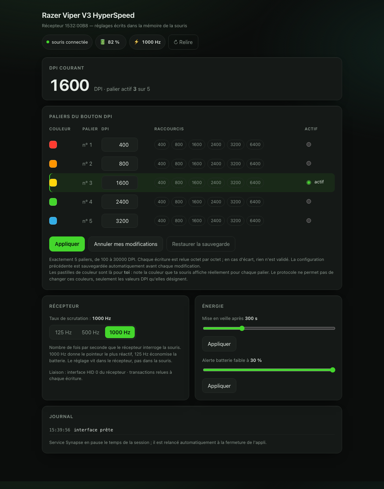

# viper-v3hs-dpi-mac

Régler les **paliers DPI** (et le reste) d'une **Razer Viper V3 HyperSpeed** sous macOS,
là où Synapse ne le permet pas.

Synapse pour macOS (0.8.11) voit bien la souris en USB (`1532:00B8`) mais ne propose
aucun réglage pour ce modèle : impossible de toucher aux paliers du bouton DPI.
Cet outil parle directement au récepteur en HID et écrit dans la mémoire de la souris.

## Installation

    git clone https://github.com/pegasus243/viper-v3hs-dpi-mac.git
    cd viper-v3hs-dpi-mac
    python3 -m venv venv
    ./venv/bin/pip install -r requirements.txt

## L'interface graphique

    ./dpi-app.sh

…ou double-clic sur **`Viper DPI.command`** depuis le Finder. L'interface s'ouvre sur
<http://127.0.0.1:8787>. **Ctrl-C**, ou fermer la fenêtre du terminal, pour quitter.

Elle permet de :

- modifier les **5 paliers du bouton DPI** et choisir le palier actif ;
- noter la **couleur** que la souris affiche pour chaque palier (mémo local : le
  protocole ne permet pas de changer ces couleurs, seulement les DPI qu'elles désignent) ;
- régler le **taux de scrutation** du récepteur (125 / 500 / 1000 Hz) ;
- régler la **mise en veille** (60–900 s) et le **seuil d'alerte batterie** (5–30 %) ;
- lire batterie, état de charge et DPI courant ;
- **restaurer** la configuration sauvegardée avant la dernière modification.

Le serveur n'écoute que sur `127.0.0.1`, ne fait aucune requête sortante, et la page
n'utilise aucune ressource externe — elle fonctionne hors ligne. Les requêtes d'écriture
exigent un en-tête maison et une origine locale, pour qu'un site ouvert dans un autre
onglet ne puisse pas piloter la souris pendant que l'appli tourne.

## En ligne de commande

    ./dpi.sh                                    # affiche la config actuelle
    ./dpi.sh 400 800 1600 2400 3200             # écrit les 5 paliers
    ./dpi.sh 400 800 1600 2400 3200 --active 2  # + choisit le palier actif
    ./dpi.sh --restore stages-backup.hex        # revient à la sauvegarde

Il faut **exactement 5 valeurs** (100 à 30000) : changer le nombre de paliers n'est pas
supporté. Chaque écriture est relue octet par octet et échoue bruyamment en cas d'écart.
`stages-backup.hex` est réécrit avant chaque modification.

## Le piège qui fait perdre des heures

Le service de fond de Synapse (`com.razer.gms`) parle au récepteur en parallèle et fait
échouer **toutes** les transactions de configuration avec le statut `0x04` (timeout),
alors que la souris continue de fonctionner parfaitement — le symptôme ne désigne donc
pas le coupable. L'appli et `dpi.sh` arrêtent l'agent launchd le temps de l'opération et
le relancent en sortant, y compris sur Ctrl-C.

Autre détail : sur les 9 collections HID du récepteur, seule l'interface 0 (souris seule)
s'ouvre. Les interfaces 1 et 2 contiennent une collection clavier et macOS les refuse.
L'interface 0 suffit pour toute la configuration.

## Testé sur

Viper V3 HyperSpeed + récepteur d'origine `1532:00B8`, macOS 26.5.1 (Apple M2),
Synapse 0.8.11 installé. Les paliers écrits survivent à l'extinction de la souris.
Le nombre de paliers reste figé à 5.

## Contenu

| Fichier | Rôle |
|---|---|
| `dpi-app.sh`, `Viper DPI.command` | lanceurs de l'interface graphique |
| `server.py` | serveur local : sert `ui.html`, expose `/api/…`, met Synapse en pause |
| `ui.html` | l'interface, sans aucune dépendance |
| `razer_hid.py` | protocole HID, encodage des réglages, gestion du service Synapse |
| `dpi.sh`, `probe.py`, `set_stages.py` | la voie ligne de commande |

## Crédits

Le protocole de ce récepteur a été documenté par
[open-Viper3HS](https://github.com/hitsmaxft/open-Viper3HS) (page de configuration
WebHID + pont local) et par [OpenRazer](https://github.com/openrazer/openrazer).
`razer_hid.py` est une implémentation indépendante à partir de cette documentation.

## English summary

Synapse for macOS does not support the Razer Viper V3 HyperSpeed, so its DPI stages
cannot be changed. This is a local app (Python HID bridge + offline web UI on
`127.0.0.1`) to edit the onboard DPI stages, active stage, polling rate, idle time and
low-battery threshold. Every write is read back byte for byte. Note that Synapse's
background agent (`com.razer.gms`) hijacks the configuration channel and makes every
transaction fail with status `0x04`; the app stops it while running and restores it on
exit.

Licence MIT.
